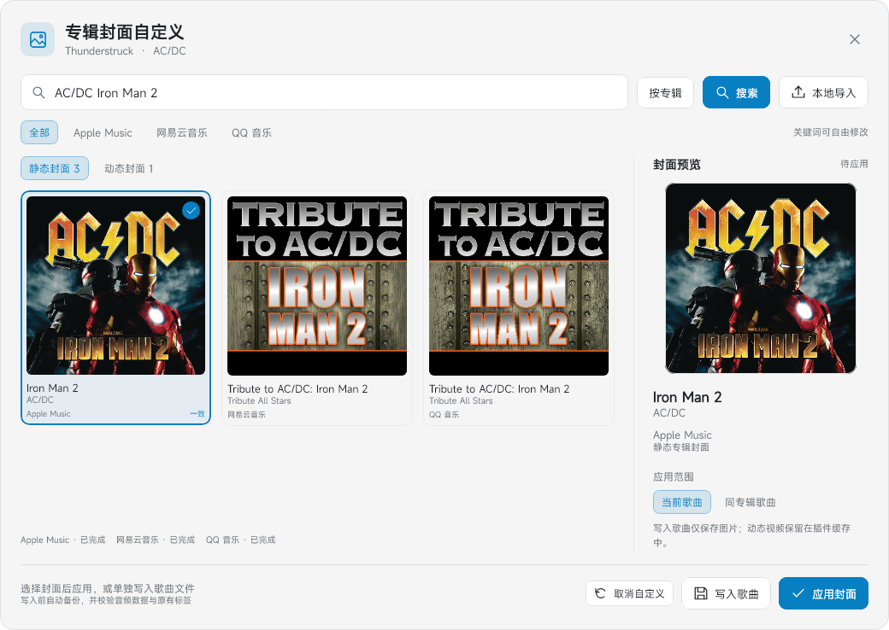

# spw 动态专辑封面/专辑封面自定义

Salt Motion 为 **Salt Player for Windows（椒盐音乐）** 提供 Apple Music 动态专辑封面，以及歌曲右键菜单中的专辑封面自定义。

**当前版本：0.2.2** · [下载安装包](https://github.com/asukua/salt-motion/releases/latest) · [发行记录](https://github.com/asukua/salt-motion/releases)

0.2.2 适配 Salt Player 1.19.3，并移除启动时的版本不适配提示。插件会先核验实际接口；如果无法安全识别，相关功能将静默回退。未来版本如改变关键接口，仍可能需要更新插件。

目前适配 **Windows / Steam 版 SPW 1.19.2 和 1.19.3**。1.19.3 已在隔离环境中验证菜单、播放页接入和封面编辑器；实际播放器窗口仍需导入后验收。

## 功能

- 在播放页静音循环显示 AM 方形动态专辑封面，支持方形 / 圆形封面布局。
- 使用 AM 网页提供的最高分辨率方形 SDR 视频，按专辑缓存并在歌曲间复用。
- 动画目标帧率默认 30 FPS，可选 24 FPS；实际刷新率受设备解码与绘制性能影响。
- 在歌曲右键菜单的“专辑”下方加入带图标的 **专辑封面自定义**。
- 搜索 Apple Music、网易云音乐、QQ 音乐，允许自行修改歌手、歌名、专辑名等关键词，切换按专辑 / 按歌曲搜索。
- 静态封面与动态封面独立展示，支持封面预览、本地图片导入，应用到当前歌曲或标签一致的同专辑歌曲。
- 可将静态图片写入歌曲元数据，写入前自动备份并检查原有标签和音频数据。
- 界面跟随播放器的字体、深浅色和强调色，包括 **MiSans Regular**。


<details>
<summary>浅色界面</summary>



</details>

截图来自生产 Compose 组件的独立渲染场景，展示字体与布局。

## 安装

1. 在 [Releases](https://github.com/asukua/salt-motion/releases/latest) 下载 **plugin-dev.saltmotion-0.2.2.spmod**，无需下载源码。
2. 打开 SPW → 创意工坊 → 模组管理 → 导入模组，选择该文件。
3. 启用 **Salt Motion**，按播放器提示授予修改应用行为与界面、读取音乐库、修改音乐库权限。

更新沿用插件 ID `dev.saltmotion`，导入新包时切换同一插件的版本。最高画质视频和已保存的自定义封面可继续复用。

## 使用

播放歌曲后打开播放页，插件按“专辑艺人 + 专辑名”匹配 AM；专辑艺人缺失时使用歌曲艺人。首次加载需要网络，没有可用素材时保留原封面。公开封面读取不需要 Apple Music 账号或订阅；并非所有专辑都有动态素材。

右键任意歌曲 → **专辑封面自定义**。搜索框的关键词可自由修改，适合本地标签错误的歌曲。通过来源和静态 / 动态标签筛选结果，也可本地导入图片。当前动态素材来自 AM。

- **应用封面**：保存插件自己的图片映射，更新播放器封面显示。
- **写入歌曲**：将图片嵌入音频文件的封面元数据。动态候选写入其静态专辑图，动态视频留在插件缓存中。
- **取消自定义**：移除插件映射，不撤销已写入歌曲的图片。

元数据写入已在 FLAC、MP3、WAV 副本上验证；其他已实现格式仍需真实文件验证。完整备份位于插件数据目录 `cover-backups`。同专辑批量写入按歌曲逐个完成，错误时报告已完成数量。

自动匹配要求规范化后的专辑名和艺人完整一致，不自动忽略 Deluxe、Live、重录版等版本信息。遇到不同发行版本，可在编辑器明确选择，或在插件设置中指定 AM 专辑：

```text
Nirvana | Nevermind = https://music.apple.com/us/album/nevermind/1440783617
```

地区顺序默认 `US,JP,CN`，可在设置修改。网络失败时可查看插件数据目录中的 `diagnostics.log`，不应把请求失败直接当成专辑没有动态封面。

## 构建与验证

需要 **JDK 25**。项目使用 Gradle Wrapper 9.8.0、Kotlin / Compose 2.4.20、Workshop API dev23；首次构建需访问 Maven Central、Google Maven 和 JitPack。

```powershell
$env:JAVA_HOME = 'C:\path\to\jdk-25'
.\gradlew.bat test plugin
python scripts/verify-package.py build/libs/plugin-dev.saltmotion-0.2.2.spmod
```

宿主精简运行时验证（JDK 版本应与 SPW runtime 相同）：

```powershell
.\scripts\verify-runtime.ps1 `
  -HostRuntime 'C:\path\to\Salt Player for Windows\runtime' `
  -HostArchive 'C:\path\to\Salt Player for Windows\app\ffmpeg-x64.dll' `
  -JdkHome $env:JAVA_HOME
```

脚本只在工作区复制运行时，并使用独立 JVM；不附加到正在运行的播放器。`scripts/verify-editor.ps1` 提供原生菜单、界面交互和副本写入验证，`-Online` 可执行公开来源检索。

[0.2.2 验证记录](docs/release-0.2.2.md) · [0.2.1 验证记录](docs/release-0.2.1.md) · [0.2.0 验证记录](docs/release-0.2.0.md) · [封面编辑器设计](docs/cover-studio.md) · [搜索与匹配](docs/search.md) · [视频缓存与取帧](docs/cache-and-frames.md)

## 开源与归属

项目使用 [Apache-2.0](LICENSE)，第三方归属见 [NOTICE](NOTICE)。部分实现改编自 [Salt Artist](https://github.com/asukua/salt-artist)。宿主提供 Kotlin、Compose、Skia、JNA 和解码能力，安装包仅另带 OkHttp / Okio。封面、音乐及商标的权利属于各自权利人，素材在运行时从对应服务获取。
