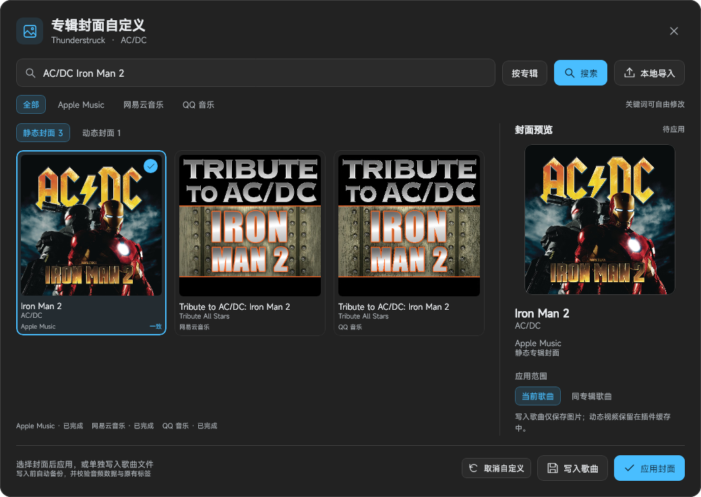

# spw 动态专辑封面/专辑封面自定义

Salt Motion 为 **Salt Player for Windows（椒盐音乐）** 提供 Apple Music 动态专辑封面，以及歌曲右键菜单中的专辑封面自定义。

**当前版本：0.2.2** · [下载插件](https://github.com/asukua/salt-motion/releases/latest) · [发行记录](https://github.com/asukua/salt-motion/releases)

支持 Windows / Steam 版 Salt Player 1.19.2 和 1.19.3。接口无法确认兼容时，相关功能会回退；1.19.3 的实际窗口效果仍需导入后检查。

## 功能

- 播放页显示 Apple Music 动态专辑封面，支持方形或圆形布局、本地缓存及帧率设置。
- 通过歌曲右键菜单搜索 Apple Music、网易云音乐和 QQ 音乐的封面，也可导入本地图片。
- 自定义封面可应用于当前歌曲或同专辑歌曲，界面跟随播放器外观。
- 可选将静态封面写入歌曲元数据，写入前自动备份；动态视频保留在插件缓存中。

浅色界面

## 安装与使用

1. 从[发布页](https://github.com/asukua/salt-motion/releases/latest)下载 `.spmod`，在椒盐音乐「创意工坊 → 模组管理」中导入并启用。
2. 按提示授予修改应用行为与界面、读取和修改音乐库的权限。
3. 播放歌曲时查看动态封面，或右键歌曲选择「专辑封面自定义」。

「应用封面」保存插件内的映射；「写入歌曲」会修改音频文件的封面元数据，备份保存在插件数据目录 `cover-backups`。取消自定义不会撤销已写入的图片。元数据写入已使用 FLAC、MP3、WAV 副本验证。

动态封面需要网络，且并非所有专辑都有可用素材；加载失败时保留原封面。搜索、地区顺序及手动匹配见[搜索与匹配](docs/search.md)。

## 构建

使用 JDK 25，运行 `./gradlew test plugin`。更多信息见[封面编辑器设计](docs/cover-studio.md)、[视频缓存与取帧](docs/cache-and-frames.md)和[版本验证记录](docs/release-0.2.2.md)。

项目使用 [Apache-2.0](LICENSE)，第三方归属见 [NOTICE](NOTICE)。部分实现改编自 [Salt Artist](https://github.com/asukua/salt-artist)。
